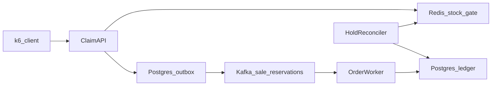

# Flash Sale Platform

A high-concurrency flash-sale **reservation service**: one product drop, limited
stock, a sudden spike of buyers, and a hard guarantee that the system never
sells more units than it has.

Built as the Applied Software Project (backend specialization) for the
Scaler Neovarsity / Woolf M.Sc. in Computer Science.

> Status: initial setup. Infrastructure, build and package layout are in place;
> domain, API and load tests are added incrementally (see commit history).

## What the system guarantees

| Invariant | How it is enforced |
|---|---|
| No oversell | Atomic Redis Lua decrement as the fast gate; conditional `UPDATE ... WHERE stock > 0` in Postgres as the durable backstop |
| No double claim | Per-user limit and `Idempotency-Key` checked inside the same Lua script |
| One order per reservation | Kafka consumer inserts with `ON CONFLICT DO NOTHING` (at-least-once delivery, idempotent write) |
| Abandoned holds return to stock | Holds carry a TTL; a reconciler releases expired holds and checks `confirmed + active holds + redis remaining == initial stock` |

## Architecture



Claim flow for one unit:

1. `POST /sales/{saleId}/claims` with `Idempotency-Key` and `userId`.
2. Redis Lua script: check stock, per-user limit, idempotency key; decrement; write hold with TTL.
3. Same Postgres transaction: insert `PENDING` reservation + outbox row. Return `202` (or `409` sold out / duplicate).
4. Outbox relay publishes to `sale.reservations` keyed by `saleId`.
5. Order worker confirms the reservation and creates the order idempotently; payment failure releases the hold.
6. Reconciler expires stale holds and asserts the stock invariant.

A **baseline** strategy (plain SQL decrement, order written in the request thread,
no Redis/Kafka) is kept behind a flag purely for the before/after benchmark.

## Tech stack

- Java 25, Spring Boot 4.0.2 (Web MVC, Data JPA, Data Redis, Kafka, Validation, Actuator)
- PostgreSQL 16 (order ledger, transactional outbox), Flyway migrations
- Redis 7 (atomic stock gate, holds)
- Apache Kafka 3.9 in KRaft mode (async order pipeline)
- JUnit 5 + Testcontainers for correctness tests, k6 for load tests
- Docker Compose for local infrastructure

## Repository layout

```
.
├── compose.yaml                 # Postgres, Redis, Kafka for local dev / load tests
├── pom.xml                      # Spring Boot 4.0.2 parent, Java 25
├── mvnw, mvnw.cmd               # Maven wrapper (no local Maven needed)
├── docs/                        # Design notes and report material (diagrams, benchmarks)
├── load-test/                   # k6 scripts and recorded results
└── src
    ├── main/java/com/keshari/flashsale
    │   ├── api/                 # REST controllers, DTOs, error mapping
    │   ├── application/         # Use-case services, ports
    │   ├── domain/              # Entities and invariants
    │   ├── infrastructure/
    │   │   ├── persistence/     # JPA repositories, outbox
    │   │   ├── cache/           # Redis Lua stock gate
    │   │   └── messaging/       # Kafka outbox relay + order worker
    │   └── config/              # Spring configuration
    ├── main/resources
    │   ├── application.yml
    │   └── db/migration/        # Flyway SQL migrations
    └── test/java/...            # Unit, concurrency and Testcontainers tests
```

## Running locally

Prerequisites: JDK 25, Docker (Docker Desktop or Colima). Maven is downloaded by the wrapper.

```bash
# start infra + app (Spring Boot docker-compose support starts compose.yaml)
./mvnw spring-boot:run

# or manage infra yourself
docker compose up -d
./mvnw spring-boot:run
```

Ports (chosen to avoid clashing with a locally installed Postgres / Pulsar):

| Service | Host port |
|---|---|
| App | 8085 |
| Postgres | 55432 (`flashsale` / `flashsale`) |
| Redis | 56379 |
| Kafka | 9092 |

Health: `http://localhost:8085/actuator/health`

## Testing

```bash
./mvnw test          # JUnit 5; integration tests use Testcontainers (Docker required)
```

Load tests (k6) live in `load-test/` and simulate 1,000,000 purchase attempts
with a bounded number of virtual users. Results are recorded per run in
`load-test/results/` for the baseline and optimized strategies.

## Deployment design (AWS)

Documented in `docs/`: Elastic Beanstalk environments for API and worker inside
one VPC, RDS PostgreSQL, ElastiCache Redis, Amazon MSK, with security groups
allowing app -> data-tier traffic only.
