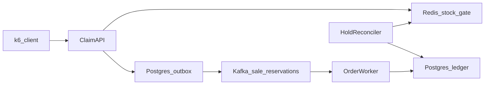

# Flash Sale Platform

A high-concurrency flash-sale **reservation service**: one product drop, limited
stock, a sudden spike of buyers, and a hard guarantee that the system never
sells more units than it has.

Built as the Applied Software Project (backend specialization) for the
Scaler Neovarsity / Woolf M.Sc. in Computer Science.

> Status: in progress (see commit history). Done: schema, domain, admin API,
> claim path, SQL and Redis gates, outbox relay, Kafka order worker, simulated
> payment, hold reconciler, k6 baseline 1M. Next: JWT, rate limiting, optimised 1M.

## What the system guarantees

| Invariant | How it is enforced |
|---|---|
| No oversell | Atomic Redis Lua decrement as the fast gate; conditional `UPDATE ... WHERE stock > 0` in Postgres as the durable backstop |
| No double claim | Per-user limit and `Idempotency-Key` checked inside the same Lua script |
| One order per reservation | Kafka consumer inserts with `ON CONFLICT DO NOTHING` (at-least-once delivery, idempotent write) |
| Abandoned holds return to stock | Holds carry a TTL; a reconciler releases expired holds and checks `confirmed + active holds + redis remaining == initial stock` |

## Architecture



Claim flow for one unit:

1. `POST /api/v1/sales/{saleId}/claims` with an `Idempotency-Key` header; buyer identity comes from the authenticated principal (`X-Buyer-Id` header until the JWT resource server lands), never from the body.
2. `StockGate.tryReserve`: Redis Lua script (optimised) or conditional SQL `UPDATE` (baseline) decides accepted / sold-out / duplicate / replay.
3. One short Postgres transaction: insert `PENDING` reservation + outbox row. Return `202` with `Location` (or `200` replay, `409` sold-out / duplicate-claim / sale-not-open).
4. Outbox relay publishes `ReservationAccepted` to `sale.reservations`, keyed by reservation id.
5. Order worker confirms the reservation and creates the order idempotently; payment failure releases the hold.
6. Reconciler expires stale holds and asserts the stock invariant.

The **baseline** strategy (`flashsale.gate=sql`) exists only for the before/after
benchmark; `flashsale.gate=redis` selects the optimised path. Controller, service
and tests are identical for both.

### API

| Method | Path | Purpose |
|---|---|---|
| POST | `/api/v1/admin/sales` | Create a sale (SCHEDULED) |
| POST | `/api/v1/admin/sales/{id}/open` | Open; loads stock into the gate |
| POST | `/api/v1/admin/sales/{id}/close` | Close |
| GET | `/api/v1/admin/sales[/{id}]` | Inspect |
| GET | `/api/v1/admin/sales/{id}/stats` | Stock + reservation counts, oversell |
| GET | `/api/v1/admin/sales/{id}/invariant` | `confirmed + pending + gate remaining == initial stock` |
| POST | `/api/v1/admin/sales/{id}/reconcile` | Expire stale holds, then return the invariant |
| POST | `/api/v1/sales/{id}/claims` | Claim one unit (`Idempotency-Key` header) |
| GET | `/api/v1/reservations/{id}` | Reservation status |

Errors are RFC 9457 problem details with stable `type`s (`sold-out`,
`duplicate-claim`, `sale-not-open`, `illegal-transition`, `validation-error`, ...).

## Tech stack

- Java 25, Spring Boot 4.0.2 (Web MVC, Data JPA, Data Redis, Kafka, Validation, Actuator)
- PostgreSQL 16 (order ledger, transactional outbox), Flyway migrations
- Redis 7 (atomic stock gate, holds)
- Apache Kafka 3.9 in KRaft mode (async order pipeline)
- JUnit 5 + Testcontainers for correctness tests, k6 for load tests
- Docker Compose for local infrastructure

## Repository layout

```
.
├── compose.yaml                 # Postgres, Redis, Kafka for local dev / load tests
├── pom.xml                      # Spring Boot 4.0.2 parent, Java 25
├── mvnw, mvnw.cmd               # Maven wrapper (no local Maven needed)
├── docs/                        # Design notes and report material (diagrams, benchmarks)
├── load-test/                   # k6 scripts and recorded results
└── src
    ├── main/java/com/keshari/flashsale
    │   ├── api/                 # REST controllers, DTOs, error mapping
    │   ├── application/         # Use-case services, ports
    │   ├── domain/              # Entities and invariants
    │   ├── infrastructure/
    │   │   ├── persistence/     # JPA repositories, outbox
    │   │   ├── cache/           # Redis Lua stock gate
    │   │   └── messaging/       # Kafka outbox relay + order worker
    │   └── config/              # Spring configuration
    ├── main/resources
    │   ├── application.yml
    │   └── db/migration/        # Flyway SQL migrations
    └── test/java/...            # Unit, concurrency and Testcontainers tests
```

## Running locally

Prerequisites: JDK 25, Docker (Docker Desktop or Colima). Maven is downloaded by the wrapper.

```bash
# start infra + app (Spring Boot docker-compose support starts compose.yaml)
./mvnw spring-boot:run

# or manage infra yourself
docker compose up -d
./mvnw spring-boot:run
```

Ports (chosen to avoid clashing with a locally installed Postgres / Pulsar):

| Service | Host port |
|---|---|
| App | 8085 |
| Postgres | 55432 (`flashsale` / `flashsale`) |
| Redis | 56379 |
| Kafka | 9092 |

Health: `http://localhost:8085/actuator/health`

## Testing

```bash
./mvnw test          # JUnit 5; integration tests use Testcontainers (Docker required)
```

With Colima instead of Docker Desktop, point Testcontainers at Colima's socket first:

```bash
export DOCKER_HOST="unix://$HOME/.colima/default/docker.sock"
export TESTCONTAINERS_DOCKER_SOCKET_OVERRIDE=/var/run/docker.sock
```

The build uses the project-local `.mvn/settings.xml` (Maven Central only), so it
does not depend on any corporate mirror configured in `~/.m2/settings.xml`.

Load tests (k6) live in `load-test/` and simulate 1,000,000 purchase attempts
with a bounded number of virtual users. Results are recorded per run in
`load-test/results/` for the baseline and optimized strategies.

## Deployment design (AWS)

Documented in `docs/`: Elastic Beanstalk environments for API and worker inside
one VPC, RDS PostgreSQL, ElastiCache Redis, Amazon MSK, with security groups
allowing app -> data-tier traffic only.
